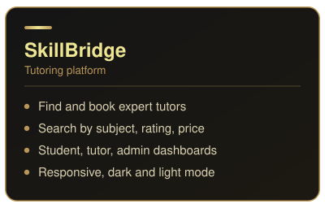
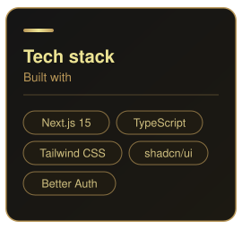
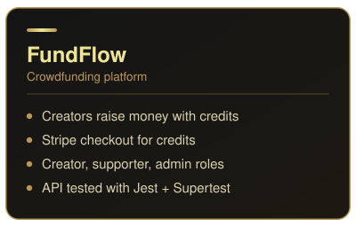
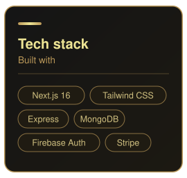
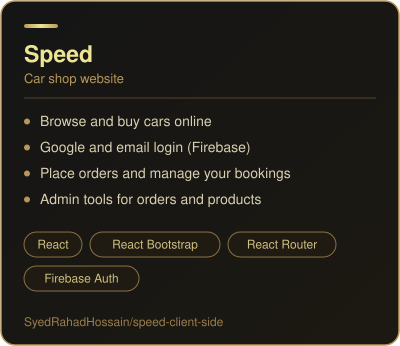
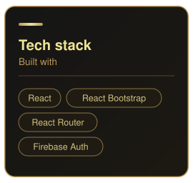
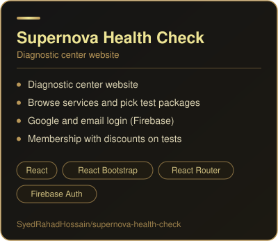

<!-- ============ BANNER ============ -->

 

 

<!-- ============ ABOUT ============ -->
<h3> About Me</h3>

🌐 I build fast, responsive websites and full-stack web apps 
🎨 I design interfaces in Figma before writing a line of code 
⚙️ Full-stack with the **MERN stack** (MongoDB, Express, React, Node.js) 
▲ Also building with **Next.js + Prisma + PostgreSQL** 
📫 Reach me at **syedrahadhossain@hotmail.com**

 

<!-- ============ TECH STACK ============ -->
<h3>🛠️ Tech Stack</h3>

  <b>Languages</b>  
  
  
  
  

  <b>Frontend &amp; UI</b>  
  
  
  
  
  
  
  

  <b>Backend &amp; Authentication</b>  
  
  
  

  <b>Databases &amp; ORM</b>  
  
  
  
  
  
  

  <b>Agentic Development</b>  
  
  
  
  
  

  <b>Deployment &amp; Tools</b>  
  
  
  
  
  

<!-- ============ GITHUB STATS ============ -->
<h3 align="center">📊 GitHub Stats</h3>

  
  

  

 

<!-- ============ PROJECTS ============ -->
<h3 align="center">🚀 Featured Projects</h3>

 

 

 

 

 

 

 

 

 

 

 

<!-- ============ CONNECT ============ -->
<h3 align="center">🤝 Let's Connect</h3>

Open to freelance work, collaborations, and interesting ideas.

  

